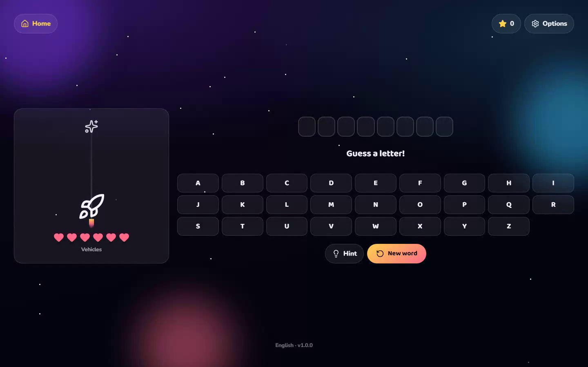
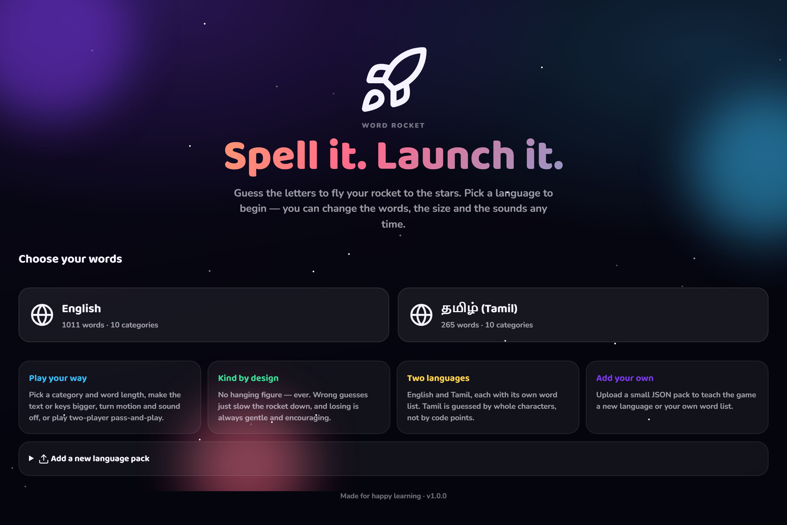
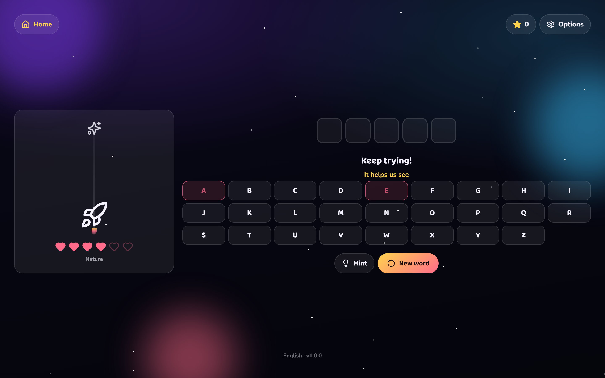
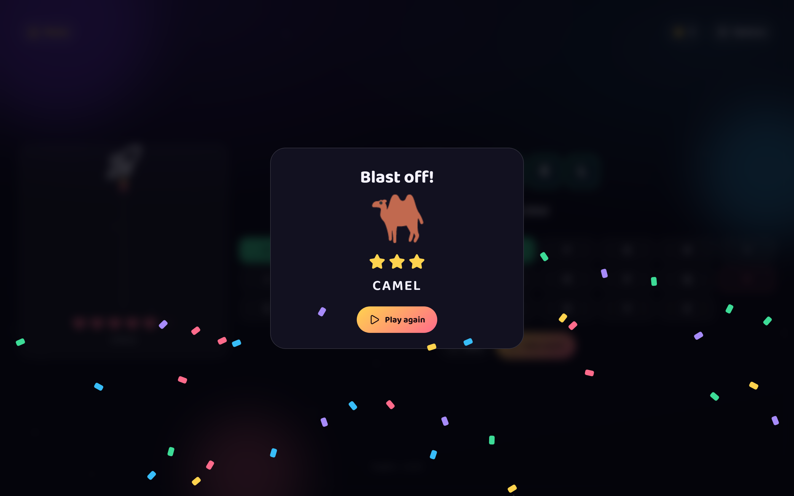
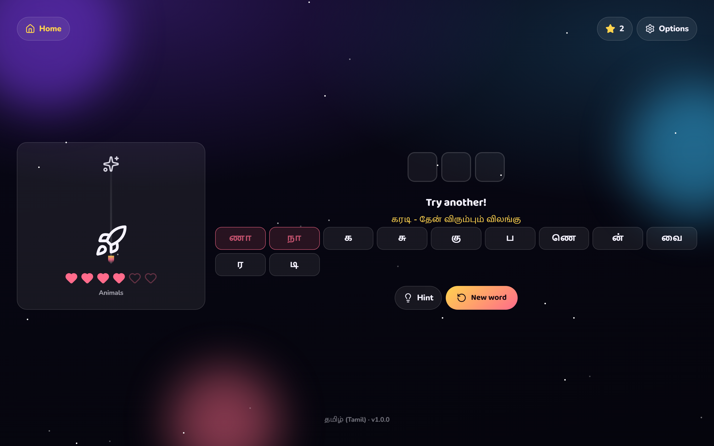

# 🚀 Word Rocket

A joyful, multilingual take on the classic **Hangman** game (CodeAlpha Task 1)
— English + Tamil, a **galaxy theme where a rocket climbs instead of a figure
hanging**, emoji picture rewards, a colorful CLI, and a fully responsive web UI.

**1,276 words** across **10 categories** per language, **11 play options**, and
**100% picture coverage** — every word rewards the player with a real image.

> **Icons:** UI chrome (buttons, settings, hint, sound...) uses the standard
> **lucide** icon package (via `hangman.icons` + `tools/icontool.py`, the same
> pattern as the sibling `support-navigator` project) — real vector icons, never
> hand-authored SVG path data. Word-reward pictures (the cat, the apple, ...)
> are a separate concern and stay on **Twemoji**, since they illustrate actual
> objects rather than UI actions.

---

## 🎬 Demo Video

A quick walkthrough — pick a language, guess letters, win a round with confetti,
and peek at the Options sheet. Click the poster to play
[`screenshots/demo.mp4`](screenshots/demo.mp4):

[](screenshots/demo.mp4)

---

## 📸 Screenshots

### 🌈 Landing page (language picker)

The joyful welcome screen — choose **English** or **தமிழ் (Tamil)**, or upload
your own language pack.



### 🎮 Game in progress

The masked word, the **rocket climbing toward the stars** as letters are found
(no gallows — ever), hearts for tries left, a hint, and the large tappable
on-screen keyboard.



### 🎉 Win screen

**"Blast off!"** with **confetti**, **star rating**, and the **emoji picture
reward** for the completed word (an English round shown here).



### 🔤 Tamil round (syllable keyboard)

Tamil is guessed at the **grapheme-cluster (syllable)** level, so the keyboard is
built from clusters — e.g. `ம்`, `ரி`, `வா` — not a fixed alphabet.



---

## ▶️ Run it

```bash
pip install -r requirements.txt
python -m hangman            # colorful terminal game
python web/app.py            # web UI at http://127.0.0.1:5000
```

## ⚙️ Play options

All eleven are in the **Options** sheet and are remembered on the device
(`localStorage`), so a child's setup survives a reload.

| Option | What it does |
| --- | --- |
| **Word category** | animals, food, nature, things, colors, body, home, vehicles, school, weather — or all |
| **Word length** | any · short (3–4) · medium (5–6) · long (7+) |
| **Text size** | small · normal · large · huge |
| **Extra big keys** | 62px key targets for small fingers |
| **Paged keyboard** | show 12 letters at a time instead of the full board |
| **Motion** | turn off all animation (also honours `prefers-reduced-motion`) |
| **Sound** | short WebAudio blips on correct/wrong guesses |
| **Read aloud** | speaks the hint and the word (Web Speech API) |
| **Always show hint** | display the clue without having to ask |
| **Two players** | pass-and-play; the turn moves on a wrong guess only |
| **Menu language** | switches the interface between English and Tamil **independently of the word language** — a Tamil-reading child can play English words |

Word length is counted in **guessable tokens**, so for Tamil it means grapheme
clusters, not code points — "short" means the same thing in both languages.

## 🧩 Word packs

Each pack is a UTF-8 JSON file. Words carry an optional `category`; packs
without one still load (their words bucket into `other`), so older packs and
user uploads keep working.

```json
{
  "language": "English",
  "code": "en",
  "direction": "ltr",
  "alphabet": ["A", "B", "..."],
  "words": [
    { "word": "CAT", "hint": "A pet that says meow",
      "image": "cat", "category": "animals" }
  ]
}
```

`tools/packtool.py` validates a pack before writing it — duplicates, empty
hints, unknown categories, non-uppercase English, non-Tamil characters in the
Tamil pack — and writes atomically, so a bad batch can never corrupt a file.

```bash
python tools/packtool.py check   # report counts + problems for both packs
```

## 📁 Project Structure

```
word-rocket/
├── src/hangman/
│   ├── __init__.py        # __version__
│   ├── __main__.py        # python -m hangman
│   ├── game.py             # HangmanGame, tokenize, choose_word
│   ├── images.py           # image_url_for(...) real emoji (Twemoji) word-reward images
│   ├── icons.py             # icon_name(role) -> lucide icon name, for UI chrome
│   ├── packs.py            # discover / load / validate / upload packs
│   ├── cli.py              # colorful terminal game
│   └── languages/          # en.json, ta.json (+ uploads/)
├── web/
│   ├── app.py              # Flask app + JSON API
│   ├── templates/          # index.html, game.html, _icons.html (generated sprite)
│   └── static/             # rocket.css, rocket.js
├── tools/
│   ├── packtool.py         # validate / write word packs atomically
│   └── icontool.py         # generate _icons.html from the packaged lucide icons
├── tests/                  # pytest suite
├── screenshots/
├── requirements.txt
├── pyproject.toml
└── README.md
```
